# COVID-19 Data Analysis Project

## 1. Project Overview

This project analyzes global COVID-19 data using Python.
It explores reported cases, deaths, testing, vaccination progress,
and country-level differences through data analysis and visualization.

The project also focuses on Bangladesh to examine its COVID-19
case trends, death trends, and vaccination progress.

## 2. Project Objectives

- Analyze global COVID-19 cases and deaths over time.
- Identify countries with high reported case and death counts.
- Explore Bangladesh's COVID-19 situation.
- Analyze vaccination progress in Bangladesh and other countries.
- Calculate and compare Case Fatality Rates (CFR).
- Examine relationships between selected COVID-19 indicators.
- Present findings through statistical summaries and visualizations.

## 3. Dataset Description

The dataset was obtained from the Our World in Data COVID-19
compact dataset.

| Dataset Information | Value |
|---|---|
| Total records after preprocessing | 629,868 |
| Total columns after preprocessing | 66 |
| Unique countries/entities | 262 |
| First available date | 2020-01-01 |
| Last available date | 2026-10-18 |

The dataset includes information about reported COVID-19 cases,
deaths, testing, hospitalizations, vaccinations, population,
and selected demographic indicators.

## 4. Tools and Technologies

- Python
- NumPy
- Pandas
- Matplotlib
- Seaborn
- Jupyter Notebook

## 5. Data Preprocessing

The preprocessing workflow included:

- Loading the COVID-19 CSV dataset.
- Inspecting dataset dimensions, data types, and missing values.
- Removing completely empty columns.
- Checking missing country and date values.
- Inspecting duplicate country-date records.
- Sorting records chronologically.
- Reviewing negative daily case and death values.
- Creating derived date and statistical features.

Missing values were not universally replaced with zero because
a missing observation does not necessarily mean zero reported cases.

## 6. Exploratory Data Analysis

The exploratory analysis examined:

- Dataset structure and descriptive statistics.
- Country-level cumulative cases and deaths.
- Global daily and monthly case trends.
- Global daily death trends.
- Bangladesh's daily and monthly case trends.
- Bangladesh's reported death trends.
- Bangladesh's vaccination progress.
- Relationships between selected numerical indicators.

## 7. Feature Engineering

The analysis included derived indicators such as:

- Case Fatality Rate (CFR).
- Year, month number, and month name.
- Cases excluding reported deaths.

Cases excluding reported deaths should not be interpreted as
actual active cases or recovered cases.

## 8. Statistical Analysis

The statistical analysis included:

- Mean, median, standard deviation, minimum, and maximum.
- Country-level cumulative case and death comparisons.
- Case Fatality Rate calculations.
- Cases and deaths per million people.
- Full vaccination coverage comparisons.
- Pearson correlation analysis.
- Spearman rank correlation analysis.

## 9. Key Findings

The project findings are generated from the processed dataset
and are documented in the accompanying CSV reports.

See the following files in the reports directory:

- global_covid_findings.csv
- top_10_cases_findings.csv
- top_10_deaths_findings.csv
- correlation_findings.csv
- bangladesh_vaccination_findings.csv
- cfr_findings.csv

## 10. Visualizations

The project visualizations are stored in the visualizations directory.
They include global trends, country comparisons, Bangladesh trends,
vaccination statistics, and correlation analysis.

## 11. Limitations

- Reported cases and deaths depend on testing and reporting practices.
- Missing values can affect country-level comparisons.
- Countries may have different latest available observation dates.
- Cumulative totals should not be interpreted as daily counts.
- Negative daily values may reflect retrospective reporting corrections.
- Correlation does not establish causation.
- Country-level vaccination and death comparisons do not prove vaccine effectiveness.
- Per-million indicators help account for population size but do not remove
  differences in demographics, healthcare systems, or reporting quality.

## 12. Conclusion

This project demonstrates how Python data analysis tools can be used
to process, explore, visualize, and statistically analyze a large
real-world public health dataset.

The analysis provides an overview of global COVID-19 trends and
a focused examination of Bangladesh. It also demonstrates the
importance of data quality, appropriate statistical interpretation,
and clear visual communication.

---

**Project:** COVID-19 Data Analysis  
**Dataset:** Our World in Data COVID-19 Compact Dataset  
**Environment:** Python and Jupyter Notebook

<!-- VISUALIZATIONS START -->

## 10. Visualizations

The following charts illustrate the major trends and comparisons
identified during the COVID-19 data analysis.

### Bangladesh Cases Trend

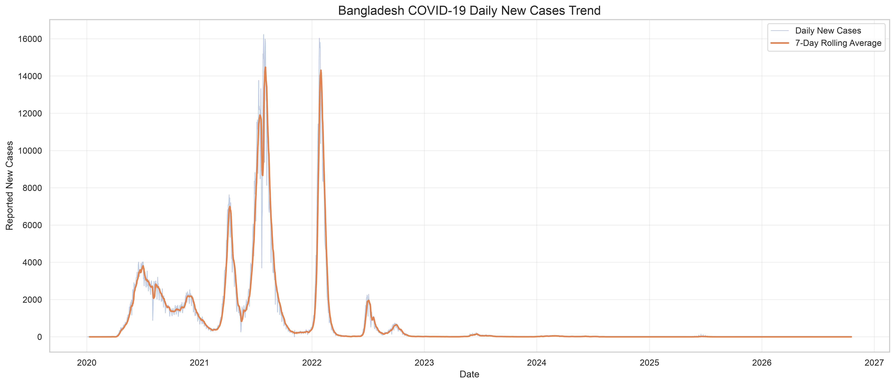

### Bangladesh Monthly Cases

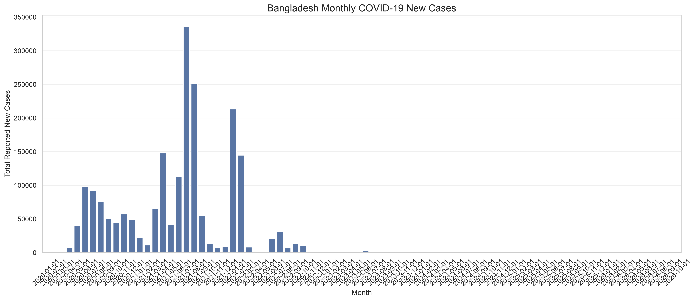

### Bangladesh Vaccination Progress

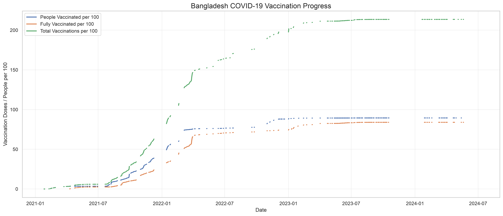

### Bangladesh Vaccination Statistics

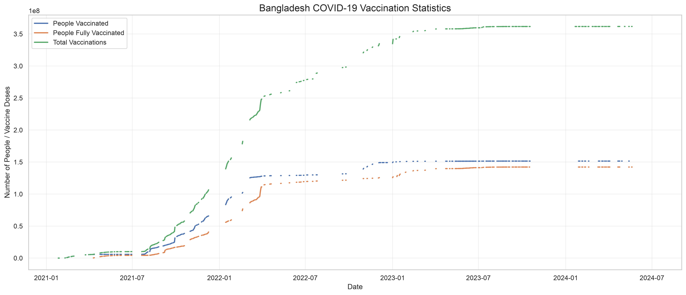

### Cases Vs Deaths Relationship

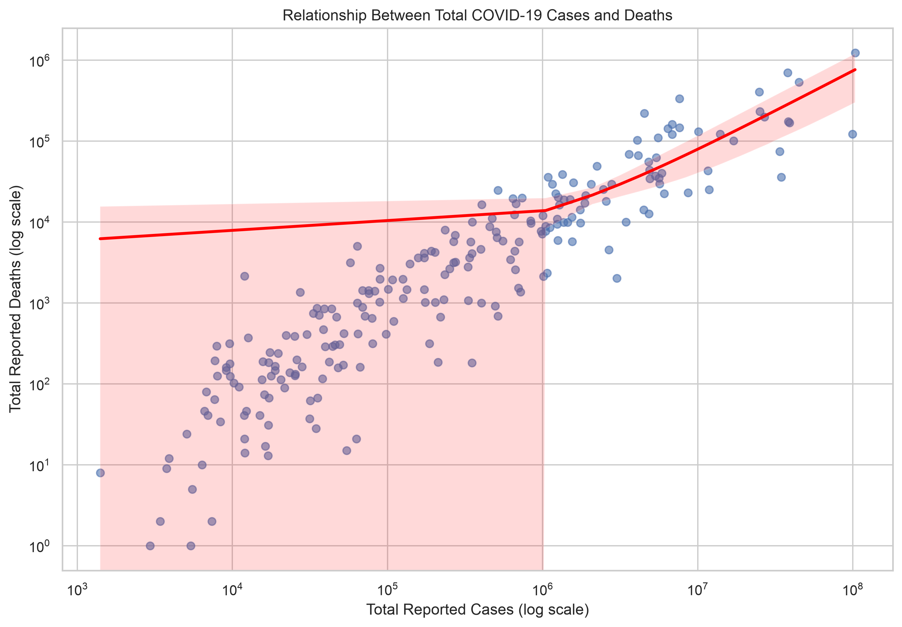

### Covid Correlation Heatmap

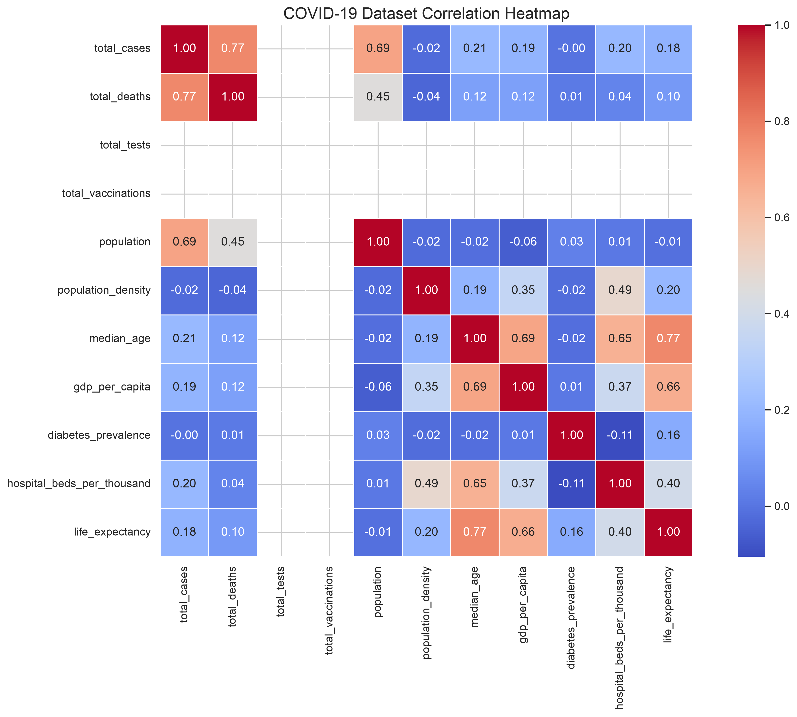

### Global Cases Trend

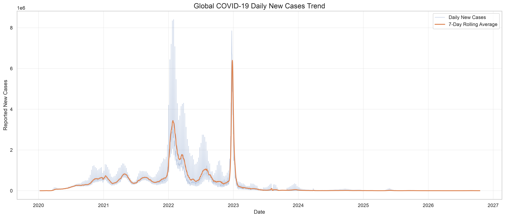

### Global Deaths Trend

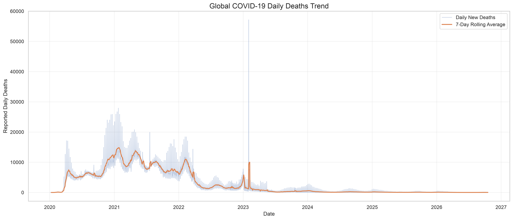

### Pearson Correlation Heatmap

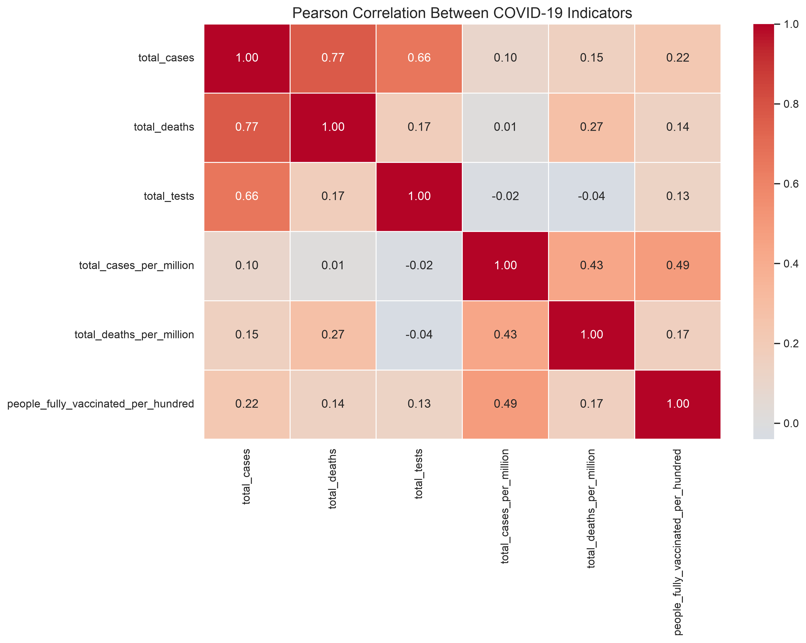

### Testing Vs Cases Relationship

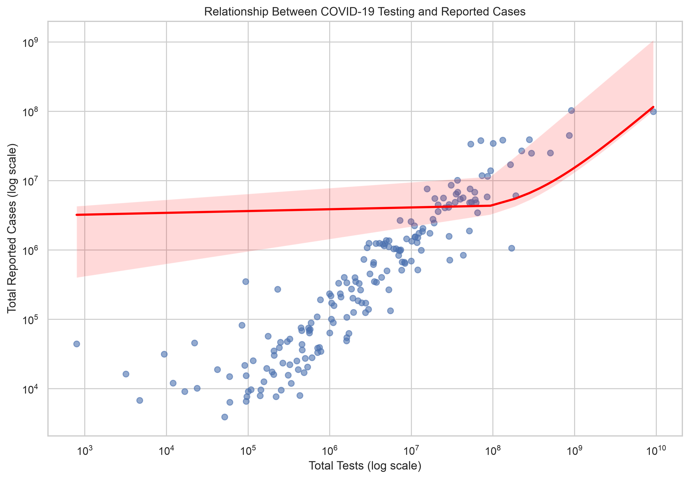

### Top 10 Countries Cases

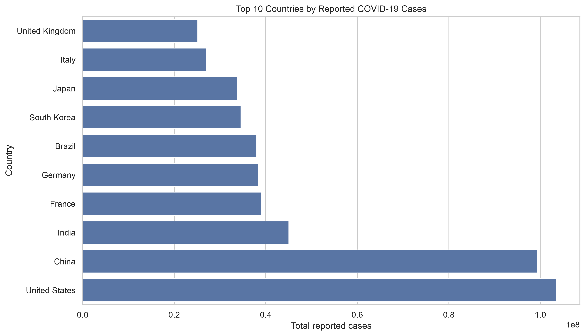

### Top 10 Countries Cfr

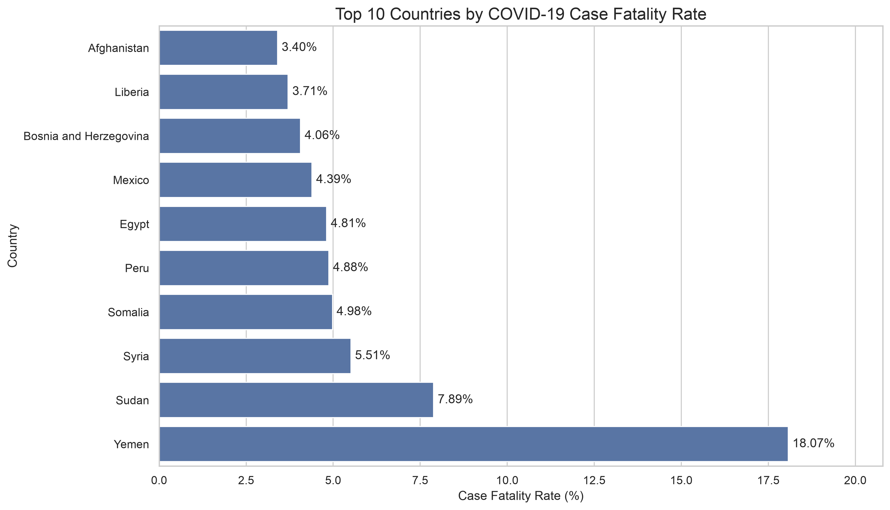

### Top 10 Countries Deaths

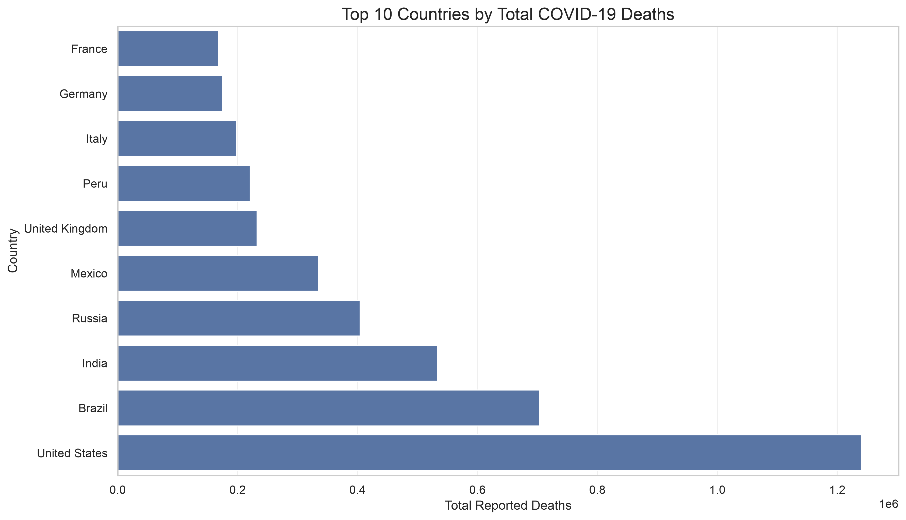

### Top 10 Countries Deaths Labeled

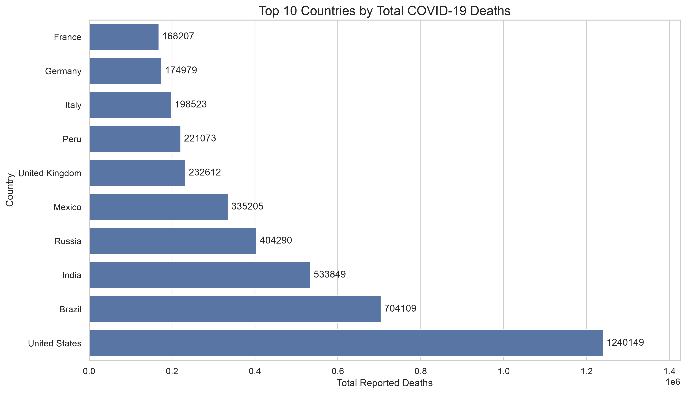

### Top 10 Deaths Per Million

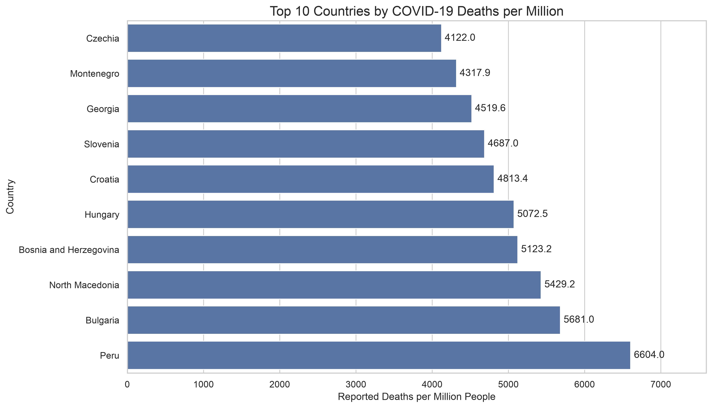

### Top 10 Vaccination Coverage

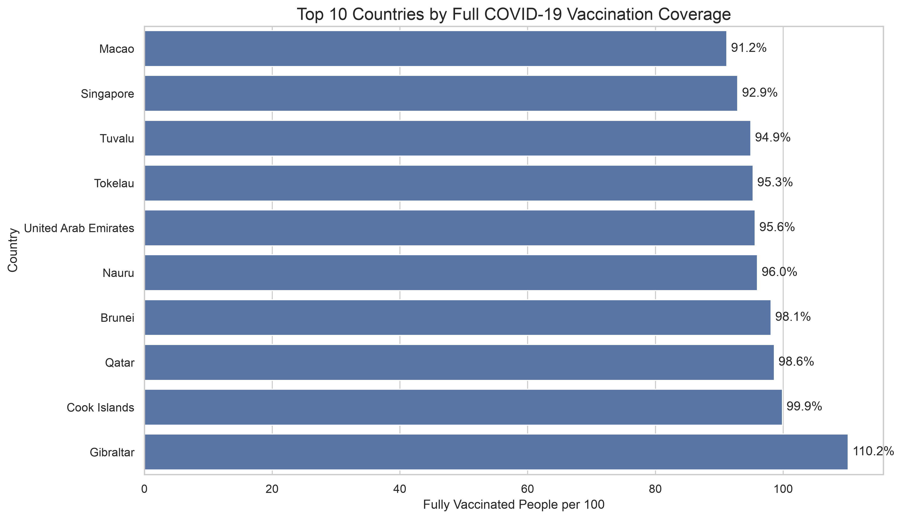

### Vaccination Vs Deaths Relationship

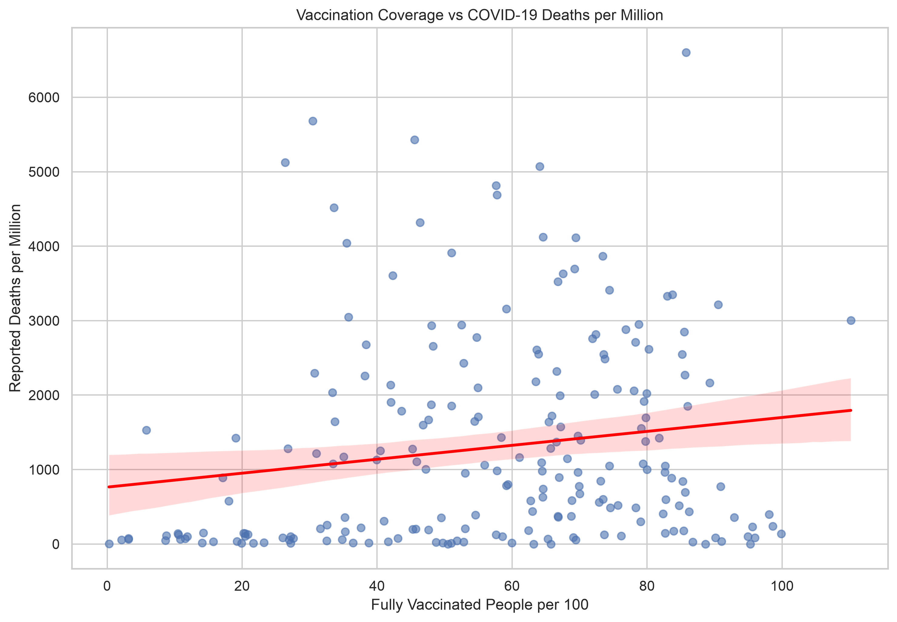

<!-- VISUALIZATIONS END -->

<!-- STATISTICAL FINDINGS START -->

## 9. Statistical Findings

This section presents the numerical findings generated from
the processed COVID-19 dataset.

### Global COVID-19 Findings

| Metric | Value |
| --- | --- |
| Peak Daily Cases Date | 2022-01-30 00:00:00 |
| Peak Daily Cases | 8401906.0 |
| Peak Daily Deaths Date | 2023-02-01 00:00:00 |
| Peak Daily Deaths | 57167.0 |
| Peak 7-Day Average Deaths Date | 2021-01-28 00:00:00 |
| Peak 7-Day Average Deaths | 14820.714285714286 |

### Top 10 Countries by Cases

| country | date | total_cases |
| --- | --- | --- |
| United States | 2026-10-18 | 103,436,829.000 |
| China | 2026-10-18 | 99,381,761.000 |
| India | 2026-10-18 | 45,056,221.000 |
| France | 2026-10-18 | 39,064,913.000 |
| Germany | 2026-10-18 | 38,437,953.000 |
| Brazil | 2026-10-18 | 38,058,695.000 |
| South Korea | 2026-10-18 | 34,571,873.000 |
| Japan | 2026-10-18 | 33,803,572.000 |
| Italy | 2026-10-18 | 26,969,918.000 |
| United Kingdom | 2026-10-18 | 25,143,403.000 |

### Top 10 Countries by Deaths

| country | date | total_deaths |
| --- | --- | --- |
| United States | 2026-10-18 | 1,240,149.000 |
| Brazil | 2026-10-18 | 704,109.000 |
| India | 2026-10-18 | 533,849.000 |
| Russia | 2026-10-18 | 404,290.000 |
| Mexico | 2026-10-18 | 335,205.000 |
| United Kingdom | 2026-10-18 | 232,612.000 |
| Peru | 2026-10-18 | 221,073.000 |
| Italy | 2026-10-18 | 198,523.000 |
| Germany | 2026-10-18 | 174,979.000 |
| France | 2026-10-18 | 168,207.000 |

### Bangladesh Vaccination Findings

| Metric | Date | Value |
| --- | --- | --- |
| People Vaccinated | 2024-06-22 | 151,507,170.000 |
| People Fully Vaccinated | 2024-07-01 | 142,201,680.000 |
| Fully Vaccinated per 100 | 2024-07-01 | 83.952 |

### Correlation Findings

| Variable 1 | Variable 2 | Pearson Correlation | Spearman Correlation |
| --- | --- | --- | --- |
| total_cases | total_deaths | 0.767 | 0.942 |
| total_tests | total_cases | 0.655 | 0.943 |
| people_fully_vaccinated_per_hundred | total_deaths_per_million | 0.166 | 0.220 |

<!-- STATISTICAL FINDINGS END -->
